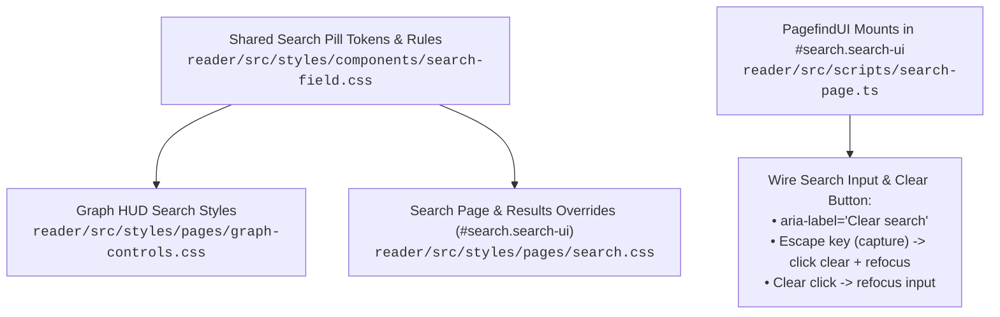

# Search Page Input Styled Like Graph Search Bar (with Clear Button)

## Goal

1. **Primary Goal**: Restyle the `/search` page's Pagefind search bar so it visually and behaviorally matches the `/graph` HUD search pill (pill radius, glassmorphic surface, magnifier icon, compact typography, and circular `✕` clear button), and refine Pagefind search results spacing and typography (`--font-sans` UI chrome with `--font-prose` excerpts).
2. **Secondary Goals**:
   - **Shared Visual Definition**: Extract shared search-field styling tokens and rules into `reader/src/styles/components/search-field.css` consumed by both `/graph` and `/search` so the two search bars cannot drift.
   - **Deterministic CSS Cascade over Pagefind UI**: Ensure custom overrides deterministically beat Pagefind's Svelte-scoped `.pagefind-ui__*.svelte-*` rules and `.pagefind-ui--reset` blanket reset regardless of `<head>` stylesheet order.
   - **Behavioral Parity with `stm-044`**: Support `Escape`-to-clear (with `{ capture: true }`, `preventDefault()`, `stopPropagation()`, and `stopImmediatePropagation()`), return focus to the search input on both `Escape` and clicking the `✕` clear button, fix Pagefind's `[SEARCH_TERM]` zero-results interpolation token, and clean up the dead `/posts/` `<noscript>` fallback link.

---

## Background & Architecture

Companion to [`stm-044-graph-search-clear-button.md`](stm-044-graph-search-clear-button.md):

- **Graph search (`/graph`)**: `.graph-search-box` in [`reader/src/styles/pages/graph-controls.css`](../../reader/src/styles/pages/graph-controls.css) renders a pill-shaped (`border-radius: var(--radius-full)`), translucent glass surface (`rgba(255, 255, 255, 0.92)` in light mode, `var(--glass-bg)` in dark mode) with a `15px` magnifier icon, borderless `var(--text-footnote)` input, and a `22px` circular `.graph-search-clear` (`✕`) button.
- **Search page (`/search`)**: [`reader/src/pages/search.astro`](../../reader/src/pages/search.astro) mounts Pagefind's default UI via [`reader/src/scripts/search-page.ts`](../../reader/src/scripts/search-page.ts) into `#search.search-ui`. Currently it is themed only through `--pagefind-ui-*` custom properties in [`reader/src/styles/pages/search.css`](../../reader/src/styles/pages/search.css), resulting in a rectangular bordered box with heavy bold text, a text `"Clear"` button, and loose default Pagefind result spacing.
- **Pagefind 1.x DOM & Stylesheet Mechanics**:
  1. `loadPagefindCss()` in [`reader/src/scripts/search-page.ts`](../../reader/src/scripts/search-page.ts) dynamically injects `<link href="/pagefind/pagefind-ui.css">` into `document.head`. Pagefind's stylesheet uses Svelte-scoped double-class selectors (`.pagefind-ui__search-input.svelte-e9gkc3`, `.pagefind-ui__search-clear.svelte-e9gkc3`, `.pagefind-ui__form.svelte-e9gkc3:before`, `.pagefind-ui__result.svelte-4xnkmf.svelte-4xnkmf`, specificity `(0, 2, 0)` to `(0, 4, 0)`) and `.pagefind-ui--reset *:where(:not(html,iframe,canvas,img,svg,video):not(svg *,symbol *)) { all: unset; }`.
  2. `.pagefind-ui__search-clear` is **always mounted** in the DOM inside `.pagefind-ui__form`; Pagefind hides it when the input is empty by toggling `.pagefind-ui__suppressed` (`opacity: 0; pointer-events: none;`).
  3. `.pagefind-ui__drawer` is rendered **inside** `.pagefind-ui__form` immediately below `.pagefind-ui__search-input` and `.pagefind-ui__search-clear`, so the pill height (`40px`) and surface must live on `.pagefind-ui__search-input` while `.pagefind-ui__form::before` and `.pagefind-ui__search-clear` anchor at `top: 20px; transform: translateY(-50%)`.

### Interaction & Styling Architecture



---

## Proposed Changes

### 1. Shared Search-Field Stylesheet (`reader/src/styles/components/search-field.css`)

Create [`reader/src/styles/components/search-field.css`](../../reader/src/styles/components/search-field.css) holding the shared custom properties for pill search bars across the reader:
- Pill container surface tokens on `:root`: `--search-pill-bg: rgba(255, 255, 255, 0.92)`, `--search-pill-border: rgba(203, 213, 225, 0.7)`, `--search-pill-shadow: 0 2px 12px rgba(0, 0, 0, 0.06)`, `--search-pill-backdrop: blur(12px)`.
- Dark mode token overrides under both `@media (prefers-color-scheme: dark)` (`:root:not([data-theme='light'])`) and `[data-theme='dark']`: `--search-pill-bg: var(--glass-bg, rgba(28, 28, 30, 0.78))`, `--search-pill-border: var(--separator, rgba(255, 255, 255, 0.1))`, `--search-pill-shadow: 0 4px 16px rgba(0, 0, 0, 0.35)`.
- Shared SVG data-URI mask token (`--search-clear-icon-mask`) for the `✕` glyph so Pagefind's button and the graph clear button stay visually identical.

### 2. Consume Shared Styles in Graph Controls (`reader/src/styles/pages/graph-controls.css`)

- Import `../components/search-field.css` at the top of [`reader/src/styles/pages/graph-controls.css`](../../reader/src/styles/pages/graph-controls.css).
- Refactor `.graph-search-box` and `.graph-search-clear` to consume `--search-pill-bg`, `--search-pill-border`, `--search-pill-shadow`, `--search-pill-backdrop`, and `var(--color-accent, var(--color-blue))` focus outlines while preserving all existing `/graph` layout and responsive behavior.

### 3. Restyle Pagefind Form, Clear Button & Results List (`reader/src/styles/pages/search.css`)

- Import `../components/search-field.css` in [`reader/src/styles/pages/search.css`](../../reader/src/styles/pages/search.css) and tighten `.search-header` bottom spacing (`margin-bottom: var(--space-6)`).
- Scope Pagefind overrides under `#search.search-ui` (specificity `(1, 2, 0)+`) so they deterministically beat `.pagefind-ui__*.svelte-*` and `.pagefind-ui--reset *` without needing `!important`:
  - `#search.search-ui .pagefind-ui__form`: `position: relative`; style `::before` magnifier icon at `15px × 15px`, `background-color: var(--label-tertiary)`, vertically centered on the `40px` pill input (`top: 20px; left: 16px; transform: translateY(-50%)`), `opacity: 1; pointer-events: none`.
  - `#search.search-ui .pagefind-ui__search-input`: `width: 100%; height: 40px`, `border-radius: var(--radius-full, 999px)`, shared pill surface tokens (`--search-pill-bg`, `--search-pill-border`, `--search-pill-shadow`, `--search-pill-backdrop`), `padding: 0 42px 0 40px` (room for magnifier on left and `✕` button on right), `font-family: var(--font-sans)`, `font-size: var(--text-footnote, 0.8125rem)`, `font-weight: var(--weight-regular, 400)`, `color: var(--label-primary)`, placeholder `color: var(--label-quaternary)`, and `:focus-visible` accent outline (`2px solid var(--color-accent, var(--color-blue))`). Suppress `::-webkit-search-cancel-button`.
  - `#search.search-ui .pagefind-ui__search-clear`: anchored inside the right edge of the `40px` input (`position: absolute; top: 20px; right: 10px; z-index: 2; transform: translateY(-50%); width: 22px; height: 22px; padding: 0; border: none; border-radius: 50%`), `font-size: 0; line-height: 0` to hide the literal `"Clear"` text, `color: var(--label-tertiary)`, `background: transparent`, with hover state `color: var(--label-primary); background: var(--fill-secondary, rgba(120, 120, 128, 0.16))` and `:focus-visible` outline.
  - `#search.search-ui .pagefind-ui__search-clear::after`: render the `12px × 12px` `✕` icon via `mask: var(--search-clear-icon-mask) center / contain no-repeat` / `-webkit-mask` and `background-color: currentcolor` so the circular hover fill on the parent button remains unclipped.
  - `#search.search-ui .pagefind-ui__search-clear.pagefind-ui__suppressed`: `visibility: hidden; pointer-events: none;` so the suppressed clear button is hidden and removed from keyboard tab order when the input is empty.
  - **Pagefind Results Spacing & Reader Typography Integration**:
    - `.pagefind-ui__results-area`: `margin-top: var(--space-3)`.
    - `.pagefind-ui__message`: compact result count/status line (`height: auto; padding: var(--space-2) 0 var(--space-3); font-family: var(--font-sans); font-size: var(--text-footnote); font-weight: var(--weight-medium); color: var(--label-secondary)`).
    - `.pagefind-ui__result`, `.pagefind-ui__result-inner`, `.pagefind-ui__result-thumb`: tightened vertical rhythm (`padding: var(--space-4) 0; gap: var(--space-4); margin-top: 0`).
    - `.pagefind-ui__result-title` & `.pagefind-ui__result-link`: `font-family: var(--font-sans)` with title sizing `font-size: var(--text-headline); line-height: var(--leading-snug)`.
    - `.pagefind-ui__result-excerpt`: prose typography matching article reading view (`margin-top: var(--space-1); font-family: var(--font-prose); font-synthesis: style; font-size: var(--text-subheadline); line-height: var(--leading-normal); color: var(--label-secondary)`), automatically responding to `FontToggle` (`data-font="sans"`).
    - `.pagefind-ui__result-nested`, `.pagefind-ui__result-tags`, and `.pagefind-ui__button`: balanced spacing (`--space-1` to `--space-5`) and `--font-sans` button label.
  - Mobile (`@media (max-width: 600px)`): `::before` pseudo-element expanding the `.pagefind-ui__search-clear` tap target to $\ge 32\times32\text{px}$.

### 4. Client Controller Parity & Bug Fixes (`reader/src/scripts/search-page.ts`)

- In `loadPagefindCss()`, prepend `<link data-pagefind-ui-css="true">` before the first stylesheet (`link[rel="stylesheet"], style`) in `document.head` (or append if none exists) so base vendor rules precede page overrides in cascade order.
- Update `PagefindUI` `translations`:
  - `placeholder: 'Search articles or topics...'` (matching `/graph`).
  - `zero_results: 'No results for [SEARCH_TERM]'` (fixing the broken `[QUERY]` placeholder token in Pagefind 1.x).
- Export `bindSearchInputInteractions(searchRootElement: ParentNode)` invoked after `new PagefindUI(...)` mounts:
  - Query `.pagefind-ui__search-input` and `.pagefind-ui__search-clear`.
  - Set `aria-label="Clear search"` on `.pagefind-ui__search-clear` so screen readers announce the button properly when `font-size: 0` hides its text node.
  - Attach a `keydown` listener in `{ capture: true }` mode on `.pagefind-ui__search-input`: when `keyboardEvent.key === 'Escape'` and `searchInputElement.value.length > 0`, call `keyboardEvent.preventDefault()`, `keyboardEvent.stopPropagation()`, `keyboardEvent.stopImmediatePropagation?.()`, trigger `searchClearButtonElement.click()` (so Pagefind resets its internal query state and clears results), synchronously clear `searchInputElement.value = ''`, and call `searchInputElement.focus()`.
  - Attach a `click` listener on `.pagefind-ui__search-clear` that returns focus to `searchInputElement` (`searchInputElement.focus()`).

### 5. Template Cleanup (`reader/src/pages/search.astro`)

- Remove the obsolete duplicate `<noscript>` sentence linking to `withBase('/posts/')` (line 21 of [`reader/src/pages/search.astro`](../../reader/src/pages/search.astro)), keeping only the valid `withBase('/')` (`library archive`) fallback.

### 6. Unit Tests (`reader/src/scripts/__tests__/search-page.test.ts`)

- Add Vitest unit tests using `Fake` prefix conventions (`FakeSearchInputElement`, `FakeSearchClearButtonElement`, `FakeSearchRoot`) covering:
  - `aria-label="Clear search"` assignment on `.pagefind-ui__search-clear`.
  - Pressing `Escape` (registered with `{ capture: true }`) when `.pagefind-ui__search-input` has a non-empty value calls `preventDefault()`, `stopPropagation()`, `stopImmediatePropagation()`, clicks `.pagefind-ui__search-clear`, clears `value`, and refocuses the input.
  - Pressing `Escape` when `.pagefind-ui__search-input` is empty does not trigger clear or suppress propagation.
  - Clicking `.pagefind-ui__search-clear` returns focus to `.pagefind-ui__search-input`.

---

## Files to Modify

| File | Change |
| :--- | :--- |
| [`reader/src/styles/components/search-field.css`](../../reader/src/styles/components/search-field.css) | New shared search pill & clear button tokens |
| [`reader/src/styles/pages/graph-controls.css`](../../reader/src/styles/pages/graph-controls.css) | Import and consume `search-field.css` |
| [`reader/src/styles/pages/search.css`](../../reader/src/styles/pages/search.css) | Import `search-field.css` and style `#search.search-ui` Pagefind form, input, `✕` clear button, and search results typography/spacing |
| [`reader/src/scripts/search-page.ts`](../../reader/src/scripts/search-page.ts) | Update placeholder & `[SEARCH_TERM]` translation, prepend `pagefind-ui.css`, and wire `Escape` + clear-button refocus |
| [`reader/src/pages/search.astro`](../../reader/src/pages/search.astro) | Remove duplicate dead `/posts/` `<noscript>` line |
| [`reader/src/scripts/__tests__/search-page.test.ts`](../../reader/src/scripts/__tests__/search-page.test.ts) | Unit tests for search input `Escape` and clear button interactions |

---

## Verification Plan

### Automated Tests
```bash
cd reader
pnpm test
pnpm lint
pnpm lint:css
pnpm build
```

### Manual Verification
1. Build and preview the production reader (required for Pagefind index generation):
   ```bash
   cd reader
   pnpm build
   pnpm preview
   ```
2. Open `/search` and `/graph` side by side:
   - Verify the search pill height (`40px`), border radius, magnifier icon size/color, font size (`var(--text-footnote)`), and placeholder (`Search articles or topics...`) match across both pages in light and dark themes.
   - Confirm the `✕` clear button is hidden when the input is empty and cannot be focused via `Tab`.
   - Type a query: verify the `✕` button appears inside the right edge of the pill with a circular hover state.
   - Click `✕`: verify the input and search results clear and focus returns to the input.
   - Type a query and press `Escape`: verify the input and results clear and focus remains in the input.
   - Type a non-matching query: verify the empty state displays `No results for "<term>"` instead of literal `[QUERY]`.
   - Check mobile viewport ($\le 600\text{px}$): verify compact padding and $\ge 32\times32\text{px}$ clear button touch target.
